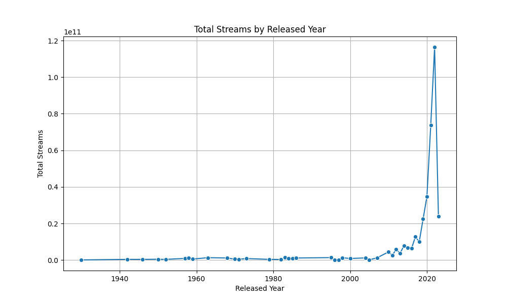
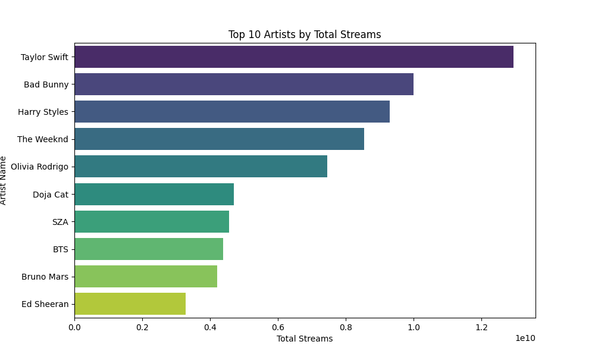
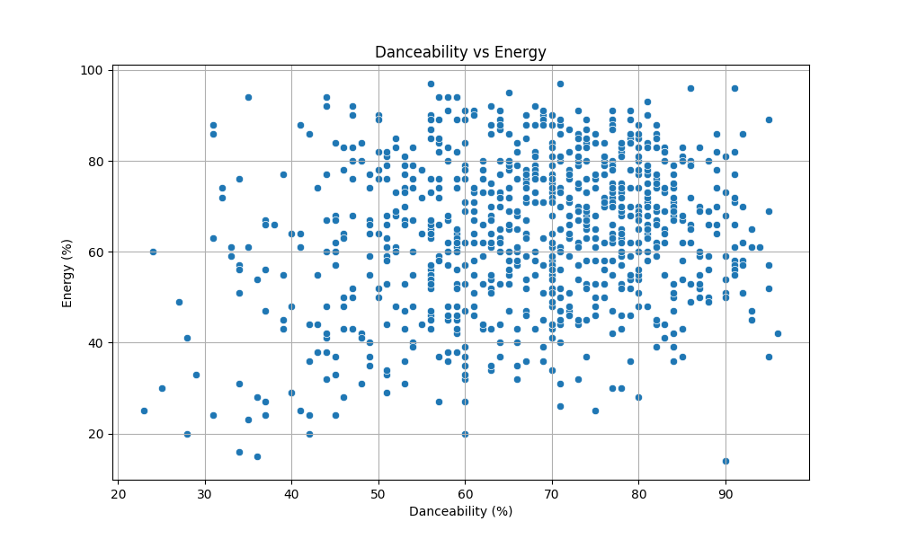
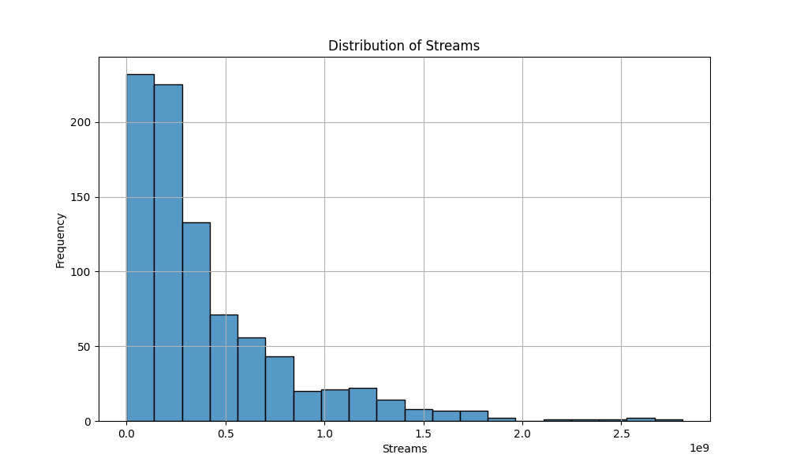
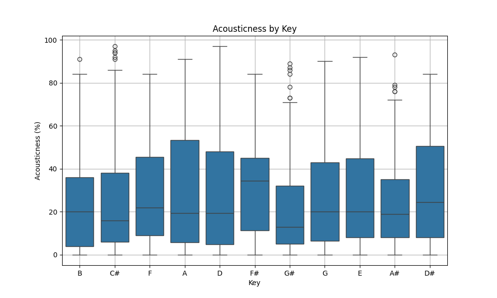

# 🎵 Music Recommendation Agent & AI Audio Studio

<p align="center">
  
  
  
  
  
  
  <a href="https://github.com/MohanKumarBH23/Music-Recommendation-Agent"></a>
</p>

<p align="center">
  An intelligent, dataset-driven <strong>Music Recommendation Agent</strong> and <strong>Interactive Audio Studio</strong> engineered from scratch using <strong>8-Dimensional Vector Space Modeling</strong>, <strong>Min-Max Normalization</strong>, <strong>Pure Cosine Similarity</strong>, and <strong>Supervised Machine Learning Stream Prediction</strong>.
</p>

<p align="center">
  <a href="#overview">Overview</a> •
  <a href="#features">Key Features</a> •
  <a href="#architecture">Architecture</a> •
  <a href="#math">Mathematical Formulation</a> •
  <a href="#installation">Installation</a> •
  <a href="#modules">Application Modules</a> •
  <a href="#eda-gallery">EDA Gallery</a> •
  <a href="#structure">Project Structure</a> •
  <a href="#license">License</a>
</p>

---

> ⚡ **100% Offline & Zero API Bottlenecks**: Engineered to operate completely standalone using raw acoustic metrics from the Spotify 2023 global dataset. No API keys, Spotify Developer accounts, token expirations, or external network requests required to deliver sub-millisecond recommendations.

---

<a id="overview"></a>
## 🌟 Overview

Modern commercial music recommendation engines often hide their algorithms behind opaque cloud services and strict API rate limits. **Music Recommendation Agent** demonstrates how fundamental linear algebra, data sanitization, and vector space modeling can deliver instant, highly relevant, and mathematically transparent music discovery right on your local machine.

The agent projects each track into an **8-dimensional acoustic hyperspace** spanning tempo, danceability, valence (musical positivity), perceptual energy, acousticness, instrumentalness, liveness, and speechiness. It computes the angular cosine separation between query vectors and the entire catalog in milliseconds, powering track matching, mood synthesis, custom vibe generation, and stream popularity forecasting.

---

<a id="features"></a>
## ✨ Key Features

- **🔍 Track-Based Content Recommender**: Select or search from 950+ worldwide hit tracks to instantly retrieve acoustic radar metrics, AI stream projections, and the top $K$ mathematically closest tracks with percentage similarity scores.
- **🎭 Mood-Based Recommender Agent**: Scientifically maps human emotional archetypes (*Happy*, *Sad*, *Energetic*, *Relaxed / Chill*, *Party*, *Romantic*) to acoustic centroid vectors in normalized feature space.
- **🎛️ Sonic Vibe Mixer (Audio Synthesizer)**: Custom multi-slider synthesizer allowing users to dial in their exact target tempo (BPM), energy, danceability, valence, acousticness, and speechiness to query matching songs.
- **🤖 Machine Learning Stream Volume Predictor**: A trained Scikit-Learn **Linear Regression** model (`spotify_model.pkl`) that estimates expected lifetime Spotify stream counts based on acoustic feature configurations.
- **📅 Historical Top Hits Discovery**: Explore top-streamed songs across decades (from 1930s catalog treasures through 2023 chart-toppers) with dynamic range filters.
- **📊 Exploratory Data Analysis (EDA) Gallery**: Curated data science visualizations uncovering streaming power laws, artist catalog dominance, and musical key acoustics.
- **🎧 Direct Spotify Integration**: One-click deep links that launch Spotify web search directly for any recommended song or artist.

---

<a id="architecture"></a>
## 🏗️ System Architecture

```mermaid
flowchart TD
    A[spotify-2023.csv\nGlobal Top Hits Dataset] --> B[Data Sanitization & Cleaning\nrecommender.py]
    B --> C[8D Feature Matrix Construction\nBPM, Dance, Valence, Energy, etc.]
    C --> D[Min-Max Normalization\nUnit Hyperspace [0, 1]^8]
    D --> E[Vector Space Indexer\nPrecomputed L2 Norms]
    
    subgraph User Query Modes
        F1[Track Matcher\nSearch by Song/Artist] --> G[Target Vector Construction]
        F2[Mood Recommender\nHappy, Sad, Party, Chill...] --> G
        F3[Sonic Vibe Mixer\nInteractive Sliders] --> G
    end

    G --> H[Pure NumPy Cosine Similarity Engine]
    E --> H
    H --> I[Ranking & Deduplication Engine]
    I --> J[Top-K Recommendations with % Match]
    
    C --> K[Trained ML Model\nspotify_model.pkl]
    K --> L[AI Global Stream Predictor]

    J --> M[Interactive Streamlit Studio\napp.py]
    L --> M
    M --> N[🎧 Spotify Direct Link]
```

---

<a id="math"></a>
## 🧠 Mathematical Formulation

The core recommendation engine in [`recommender.py`](recommender.py) is implemented strictly from foundational linear algebra principles without third-party black-box wrappers.

### 1. Acoustic Vector Space Representation
Every song $i$ in the dataset is modeled as an 8-dimensional vector $\vec{v}_i \in \mathbb{R}^8$:

$$\vec{v}_i = \begin{bmatrix} \text{BPM}_i \\ \text{Danceability}\%_i \\ \text{Valence}\%_i \\ \text{Energy}\%_i \\ \text{Acousticness}\%_i \\ \text{Instrumentalness}\%_i \\ \text{Liveness}\%_i \\ \text{Speechiness}\%_i \end{bmatrix}$$

### 2. Min-Max Normalization (Hyperspace Projection)
Because feature dimensions have disparate scales (e.g., BPM $\in [60, 210]$ while danceability $\in [0, 100]$), all dimensions are normalized into the uniform range $[0, 1]$:

$$\vec{v}_{\text{norm}, i} = \frac{\vec{v}_i - \vec{v}_{\min}}{\vec{v}_{\max} - \vec{v}_{\min}}$$

where $\vec{v}_{\min}$ and $\vec{v}_{\max}$ represent the column-wise extrema across the dataset corpus.

### 3. Pure NumPy Cosine Similarity
To gauge acoustic similarity purely by harmonic and stylistic orientation regardless of vector magnitude, directional cosine similarity is computed:

$$\text{Cosine Similarity}(\vec{u}, \vec{v}) = \frac{\vec{u} \cdot \vec{v}}{\|\vec{u}\|_2 \|\vec{v}\|_2} = \frac{\sum_{k=1}^{8} u_k v_k}{\sqrt{\sum_{k=1}^{8} u_k^2} \sqrt{\sum_{k=1}^{8} v_k^2}}$$

The similarity score is converted into an intuitive human-readable match index:

$$\text{Match Percentage} = \max\left(0.0, \; \text{Cosine Similarity}(\vec{u}, \vec{v})\right) \times 100\%$$

### 4. Supervised Machine Learning Stream Prediction
A trained linear regression model approximates expected streaming volume $\hat{y}$ from acoustic properties:

$$\hat{y}_{\text{streams}} = \beta_0 + \sum_{j=1}^{8} \beta_j X_j$$

---

<a id="structure"></a>
## 📁 Project Structure

```text
Music-Recommendation-Agent/
├── .env.example               # Template for optional Spotify Web API credentials
├── .gitignore                 # Git ignore rules for caches, venvs, and secrets
├── LICENSE                    # MIT Open-Source License
├── README.md                  # Comprehensive project documentation
├── app.py                     # Multi-page interactive Streamlit web application
├── recommender.py             # Vector space modeling, normalization & cosine engine
├── requirements.txt           # Python dependency requirements
├── spotify-2023.csv           # Curated dataset of top-streamed global tracks
├── spotify_model.pkl          # Serialized scikit-learn Linear Regression model
├── Images/                    # Exploratory Data Analysis & statistical plots
│   ├── acousticness_by_key.png
│   ├── danceability_vs_energy.png
│   ├── distribution_of_streams.png
│   ├── top_10_artists.png
│   └── total_streams_by_year.png
└── Notebook/                  # Model training and data exploration
    └── spotify_model_creation.ipynb
```

---

<a id="installation"></a>
## 🚀 Installation & Quickstart

### Prerequisites
- **Python**: 3.10, 3.11, or 3.12
- **Git** installed on your system

### 1. Clone the Repository
```bash
git clone https://github.com/MohanKumarBH23/Music-Recommendation-Agent.git
cd Music-Recommendation-Agent
```

### 2. Set Up a Virtual Environment (Recommended)
```bash
# Windows (PowerShell / Command Prompt)
python -m venv venv
.\venv\Scripts\activate

# macOS / Linux
python3 -m venv venv
source venv/bin/activate
```

### 3. Install Required Dependencies
```bash
pip install --upgrade pip
pip install -r requirements.txt
```

### 4. (Optional) Configure Spotify API Keys
The application functions **100% offline out-of-the-box**. If you wish to extend with Spotify Web API features:
```bash
cp .env.example .env
# Open .env and add your SPOTIPY_CLIENT_ID and SPOTIPY_CLIENT_SECRET
```

### 5. Launch the Streamlit Studio
```bash
streamlit run app.py
```
Your default browser will launch automatically at:
```text
http://localhost:8501
```

---

<a id="modules"></a>
## 🖥️ Application Modules

| Module | Navigation Item | Description |
|---|---|---|
| **🏠 Home Studio** | `Home` | Dataset metrics, feature breakdowns, architecture summary, and catalog statistics. |
| **🔍 Track-Based Recommender** | `Track-Based Recommendations` | Query any song in the catalog, view its acoustic fingerprint, forecast streams, and fetch the top $K$ acoustically similar tracks. |
| **🎭 Mood Recommender** | `Mood-Based Recommendations` | Select an emotional mood archetype (*Happy, Sad, Energetic, Relaxed, Party, Romantic*) to match against curated psychological acoustic vectors. |
| **🎛️ Sonic Vibe Mixer** | `Sonic Vibe Mixer` | Multi-slider acoustic synthesizer allowing users to build a custom acoustic profile and discover matching tracks. |
| **📅 Top Songs by Year** | `Top Songs by Year` | Interactive year range filter (1930–2023) to discover chart-topping catalog hits across history. |
| **📊 Visual Insights** | `Visualizations` | High-resolution data science visualizations with explanatory notes. |

---

<a id="eda-gallery"></a>
## 📊 Visual Insights & EDA Gallery

The application includes exploratory data analysis conducted on Spotify's top global streaming tracks:

<div align="center">

| Total Streams by Release Year | Top 10 Global Artists |
|:---:|:---:|
|  |  |
| *Evolution of streaming dominance across release years.* | *Global artists commanding the highest cumulative streams.* |

| Danceability vs Energy Correlation | Distribution of Global Streams |
|:---:|:---:|
|  |  |
| *Acoustic clustering across mood and intensity quadrants.* | *Power-law long-tail distribution of global streams.* |

| Acousticness Across Musical Keys |
|:---:|
|  |
| *Acoustic texture and density variations grouped by musical key signature.* |

</div>

---

## 🔬 Acoustic Feature Dictionary

| Feature | Range | Musical & Perceptual Interpretation |
|---|---|---|
| **Tempo (BPM)** | 60 – 210 | Beats per minute; tempo and rhythmic pace. |
| **Danceability (%)** | 0 – 100% | Suitability for dancing based on tempo, rhythm stability, beat strength, and regularity. |
| **Valence (%)** | 0 – 100% | Musical positiveness. High valence sounds happy/euphoric; low valence sounds sad/depressive. |
| **Energy (%)** | 0 – 100% | Perceptual measure of intensity, activity, loudness, and dynamic range. |
| **Acousticness (%)** | 0 – 100% | Confidence score whether the track is organic/acoustic versus electronic/amplified. |
| **Instrumentalness (%)** | 0 – 100% | Likelihood that the track contains no vocal content. |
| **Liveness (%)** | 0 – 100% | Detects presence of an audience in the recording (e.g., live concerts vs studio). |
| **Speechiness (%)** | 0 – 100% | Presence of spoken words (rap, podcasts, talk) versus musical singing. |

---

## 🛠️ Tech Stack

- **Core Language**: [Python 3.10+](https://www.python.org/)
- **Frontend / Application Framework**: [Streamlit](https://streamlit.io/)
- **Numerical Computation & Linear Algebra**: [NumPy](https://numpy.org/)
- **Data Engineering & Manipulation**: [Pandas](https://pandas.pydata.org/)
- **Machine Learning & Model Serialization**: [Scikit-Learn](https://scikit-learn.org/) & [Joblib](https://joblib.readthedocs.io/)
- **Data Visualization**: [Matplotlib](https://matplotlib.org/), [Seaborn](https://seaborn.pydata.org/), [Plotly](https://plotly.com/)

---

## 🤝 Contributing

Contributions, feedback, and feature requests are warmly welcomed!

1. **Fork** the repository
2. **Create** your feature branch (`git checkout -b feature/AmazingFeature`)
3. **Commit** your changes (`git commit -m 'Add some AmazingFeature'`)
4. **Push** to the branch (`git push origin feature/AmazingFeature`)
5. **Open** a Pull Request

---

## 👤 Author

**Mohan Kumar**  
- **GitHub**: [@MohanKumarBH23](https://github.com/MohanKumarBH23)  
- **Repository**: [Music-Recommendation-Agent](https://github.com/MohanKumarBH23/Music-Recommendation-Agent)

---

<a id="license"></a>
## 📄 License

This project is open-source and distributed under the **[MIT License](LICENSE)**.

---

<p align="center">
  ⭐ If you found this project helpful or inspiring, please give it a star on <a href="https://github.com/MohanKumarBH23/Music-Recommendation-Agent">GitHub</a>! ⭐
</p>